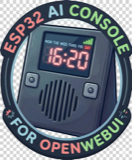
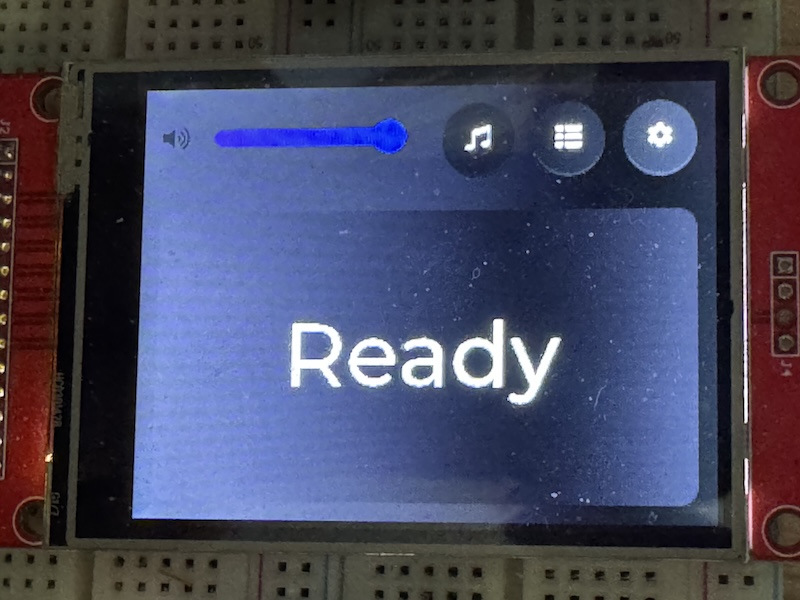
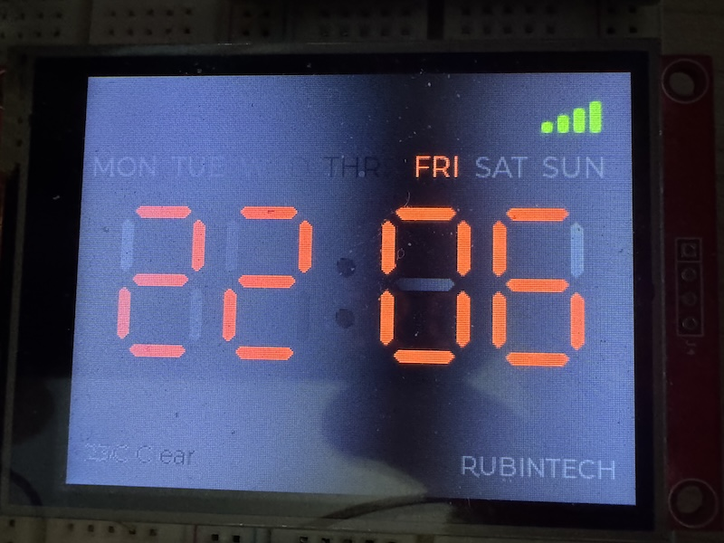
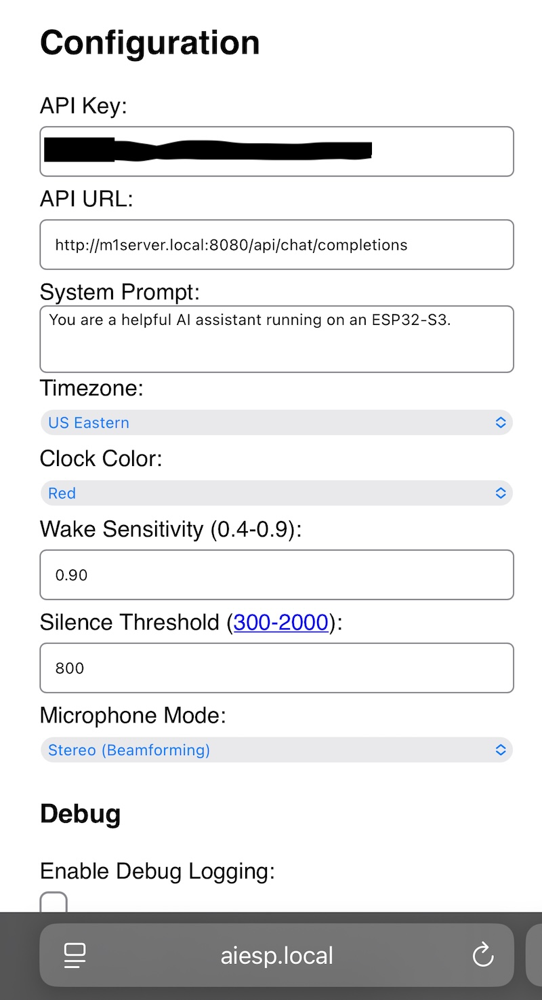

<p align="center">
  
</p>

# ESP32 AI Module (AI Interactor) — v1.0.1

[](https://github.com/jordancrubin/ESP32-AI-Module/releases)
[](LICENSE)
[](https://www.espressif.com/en/products/socs/esp32-s3)
[](https://platformio.org/)

A powerful, standalone AI Voice Assistant appliance built for the **ESP32-S3**. This project unites on-device Machine Learning wake word detection, Acoustic Echo Cancellation (AEC) with voice barge-in, streaming Large Language Models (LLMs), high-fidelity Text-to-Speech (TTS), long-term memory persistence, live web search/calendar RAG, and an LVGL touch interface into a dedicated desktop hardware unit.

Created by **Jordan Rubin** ([Rubintech](https://www.youtube.com/@rubin-tech)).

---

## 📸 Interface & Hardware Showcase

<p align="center">
  
  
  
</p>

---

## 🌟 Key Features

- **On-Device Wake Word Engine:** Always-listening neural wake word detection (`"Excuse me Hal"`) running locally via TensorFlow Lite Micro and `microWakeWord` with pre-boot synthetic self-diagnostics.
- **Acoustic Echo Cancellation (AEC) & Voice Barge-in:** Hardware-accelerated SpeexDSP AEC isolates microphone input from the device's own speaker output, allowing you to interrupt the AI mid-sentence.
- **Open-WebUI Long-Term Memory:** Seamlessly remembers personal facts across multi-turn dialogues (*"Remember that I have a cat named Spot"*, followed by *"And also remember his nickname is Spotty"*). Automatically commits memories via Open-WebUI REST API and retrieves them into contextual prompts.
- **Real-Time Calendar & Web Search RAG:** Dynamically queries upcoming calendar events and live Google/DuckDuckGo web snippets via Open-WebUI to answer schedule and real-time questions conversationally.
- **Streaming LLM Client:** Full Server-Sent Events (SSE) streaming client with automatic model fallback, chunked TTS synthesis, and prompt caching.
- **Rich LVGL Touch GUI:** Interactive 320x240 color display featuring dynamic audio VU meters, animated thinking states, model selection drawer, volume slider, clock/weather screen, and on-device touch calibration.
- **Captive Web Configuration Portal:** Out-of-the-box AP fallback mode (`http://aiesp.local`) to configure Wi-Fi credentials, API endpoints, knowledge collection IDs, TTS providers, and OTA firmware updates without re-compiling.
- **Audio Diagnostics & Auto-Tuning Suite:** Automated sine sweep generators, microphone harmonic resonance tests, and automated AEC delay/attenuation calibration.

---

## 🔌 Hardware Pinout & Wiring

Designed for the **ESP32-S3 DevKitC-1 N16R8** (16MB Flash Quad, 8MB PSRAM Octal).

| Component / Function | Pin Name | ESP32-S3 GPIO | Details |
|---|---|---|---|
| **Display (ILI9481 SPI)** | SCK / CLK | `GPIO 12` | High-speed SPI clock |
| | MOSI / SDI | `GPIO 11` | Display data in |
| | MISO / SDO | `GPIO 13` | Display data out |
| | CS | `GPIO 10` | Chip Select |
| | DC / RS | `GPIO 9` | Command / Data selection |
| | RST | `GPIO 46` | Hardware Reset |
| **Touch Screen (XPT2046)**| TOUCH_CS | `GPIO 14` | Touch Chip Select |
| | TOUCH_IRQ | `255` | Polling mode (disabled interrupt) |
| **Microphone (ICS-43434 / INMP441)** | I2S_SCK (BCLK) | `GPIO 42` | Serial clock |
| | I2S_WS (LRCL) | `GPIO 41` | Word select (left/right clock) |
| | I2S_SD (DOUT) | `GPIO 40` | Serial audio data |
| **Speaker / DAC (MAX98357A)** | SPEAKER_SCK | `GPIO 7` | Bit clock |
| | SPEAKER_WS | `GPIO 6` | Word select / LRC |
| | SPEAKER_SD | `GPIO 5` | Serial audio data in (DIN) |
| **Environmental Sensor (BME680)** | I2C SDA | `GPIO 8` | Temperature, humidity, pressure, gas |
| | I2C SCL | `GPIO 3` | I2C clock |
| **Status Indicator** | WS2812 NeoPixel | `GPIO 48` | On-board DevKit RGB LED |
| **Factory Reset Trigger** | BOOT Button | `GPIO 0` | Hold for 3s during boot to reset NVS |

---

## 🗣️ Voice Commands & Easter Eggs

In addition to open-ended LLM conversations, the appliance natively intercepts and executes local voice commands instantly:

| Spoken Phrase | Action Performed |
|---|---|
| *"Excuse me Hal"* | Triggers wake word listener and glows status LED green. |
| *"Remember that \<fact\>"* | Instantly saves \<fact\> to persistent Open-WebUI memory. |
| *"And also remember that \<fact\>"* | Multi-turn conversational memory addition. |
| *"What do you remember?"* | Queries and vocalizes user memories stored in Open-WebUI. |
| *"Set a timer for \<N\> minutes"* | Starts an on-screen background countdown timer. |
| *"Calibrate touch"* | Launches the 4-point on-screen touch screen calibration utility. |
| *"Reboot system"* / *"Restart"* | Safely restarts the ESP32-S3 module. |
| *"End conversation"* / *"Stop"* | Ends the voice session and returns to standby. |
| *"Show Blue Screen of Death"* | Displays retro Windows BSOD diagnostic easter egg. |
| *"Show Guru Meditation"* | Displays classic Amiga Guru Meditation easter egg. |

---

## 💻 Serial Monitor CLI Commands

Connect via serial at **115200 baud** to access real-time diagnostics:

| Command | Description |
|---|---|
| `/help` | List all available CLI commands. |
| `/settings` | Print all saved NVS configuration values, thresholds, and audio tuning parameters. |
| `/say <text>` | Bypasses the LLM and streams audio synthesis directly to the speaker. |
| `/new` | Clears conversation history and invalidates the memory cache. |
| `/calibrate` | Triggers the touch calibration routine. |
| `/tune_aec` | Runs the automated Acoustic Echo Cancellation alignment and delay calculation. |
| `/test_aec` | Records two 10-second audio clips (with and without AEC) to evaluate speaker isolation. |
| `/test_mic` | Records a 5-second sample to LittleFS and plays it back. |
| `/test_harmonic`| Plays a 20-second sine sweep to detect microphone enclosure resonance. |
| `/factory_reset`| Wipes all NVRAM settings and restarts into captive portal mode. |

---

## 🚀 Installation & Getting Started

### 1. Clone the Repository
```bash
git clone https://github.com/jordancrubin/ESP32-AI-Module.git
cd ESP32-AI-Module
```

### 2. Open in PlatformIO
Open the project directory in VSCode with the PlatformIO extension installed.

### 3. Build & Upload the LittleFS Filesystem
Assets such as `chime.mp3` and `logo.png` must be written to LittleFS flash:
* **PlatformIO CLI:**
  ```bash
  pio run --target uploadfs --environment esp32-s3-devkitc1-n16r8
  ```
* **VSCode UI:** Click the PlatformIO Alien icon -> `esp32-s3-devkitc1-n16r8` -> **Platform** -> **Upload Filesystem Image**.

### 4. Build & Upload Firmware
* **PlatformIO CLI:**
  ```bash
  pio run --target upload --environment esp32-s3-devkitc1-n16r8
  ```

---

## ⚙️ Initial Configuration (Captive Portal)

1. On first boot (or after a factory reset), the device will broadcast an open Wi-Fi network named **`ESP32-AI-Setup`** (or prompt on the LCD).
2. Connect your phone or computer to the setup network and navigate to `http://192.168.4.1` or `http://aiesp.local`.
3. Enter your local Wi-Fi credentials, your Open-WebUI or OpenAI API URL, and API key.
4. Tap **Save & Reboot**. The device will connect to your local network and initialize.

---

## 🎙️ AEC & Audio Tuning

Because every physical enclosure, speaker placement, and microphone cavity introduces distinct acoustic delay and reflection, you should calibrate the AEC once after mounting hardware:

1. Place the assembled unit in its final operating location.
2. Open the Serial Monitor (115200 baud) or the Web UI Diagnostics tab.
3. Send `/tune_aec`.
4. The unit will play reference sweeps, measure microphone loopback, calculate the exact buffer delay, and save optimal cancellation parameters to non-volatile flash.

---

## 📄 License & Credits

This project is licensed under the **GNU General Public License v3.0** (GPLv3) — see the [LICENSE](LICENSE) file for details.

Third-party dependencies (LVGL, ArduinoJson, SpeexDSP, microWakeWord, libhelix) remain under their respective open-source licenses.

**Designed and engineered by Rubintech (2026)**